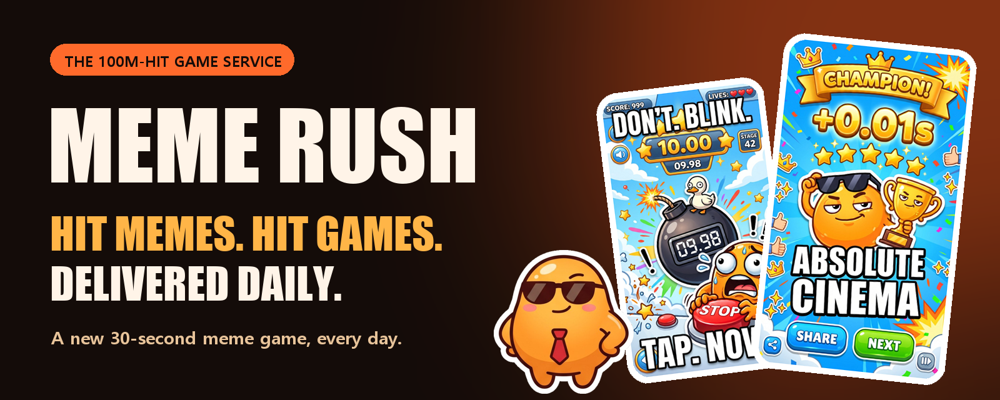
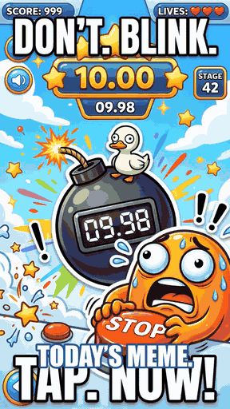
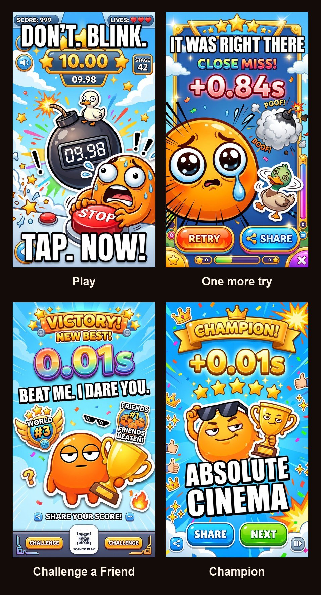
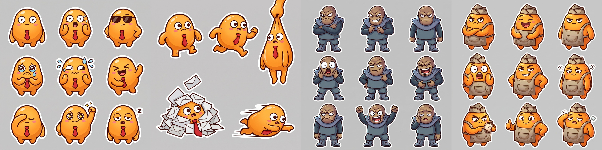

<div align="center">



**Every day, agents turn the world's hottest meme and hit game into a 30-second game and deliver it through SNS.**<br>
Stop the clock as close to the target as you can. Send the result. Beat your friends by 0.01s.


[Pre-register](https://simplifier.co.kr/preview/memerush/) (temporary page) · [Trailer (mp4)](https://meme-rush-meme-rush.vercel.app/trailer.mp4)

<a href="docs/pitch/SuperAgent_MemeRush_pitch.pdf"></a> <a href="docs/pitch/SuperAgent_MemeRush_pitch_KO.pdf"></a>

<a href="https://meme-rush-meme-rush.vercel.app/trailer.mp4"></a>

</div>

## How it works

1. **Find.** Agents collect global hit memes and hit games and score them by popularity.
2. **Build.** A hit-game format wears today's meme: a new 30-second game every day.
3. **Deliver.** One game a day, posted where memes already live (Reddit, TikTok, Discord, Telegram).
4. **Play.** One global ranking, a 10-second result video, a friend challenge link. No install.

Each round a clock runs, then hides behind the day's meme. Tap once at the target time. Three rounds, summed: **"0.087s off."**

<p align="center"></p>

<p align="center"></p>

<sub>Concept art. Names and scores are placeholders.</sub>

## Run the online demo

No install needed. Open the live admin in any browser:

**https://meme-rush-meme-rush.vercel.app/admin**

1. **Home** shows this week's games (Monday "Cut the Dalgona" is already booked).
2. **게임 등록** → pick the top topic, **Friday 5PM**. Automatic steps run between each choice.
3. Pick one of the three copy options, then an image, then a publish day (Tuesday is preselected).
4. **게임 제작 완료** → **발행하기** → confirm. The **발행 완료** screen shows the Telegram message players get; tap it to open the live game.

Notes

- **Sample data only.** The online admin is a demo mode (`ADMIN_DEMO=1` on Vercel): it runs on the sample data, never runs a command on the server and saves nothing but a small cookie.
- **Your progress lives in your browser.** The cookie keeps each visitor's run separate, so several people can try it at once. To start over, click **게임 등록** again once a run is complete, or clear the site's cookies.
- **Closing it.** Remove `ADMIN_DEMO` from the Vercel environment variables and redeploy; `/admin` then returns 404.

## Run the admin demo

The admin is where a new daily game gets made: pick a trending meme, pick the copy and the image, pick a day, publish.

```bash
cd web
npm install
ADMIN_LOCAL=1 npm run dev   # http://localhost:3000/admin
```

1. **Home** shows this week's games (Monday "Cut the Dalgona" is already booked).
2. **게임 등록** → pick the top topic, **Friday 5PM**. Automatic steps run between each choice.
3. Pick one of the three copy options, then an image, then a publish day (Tuesday is preselected).
4. **게임 제작 완료** → **발행하기** → confirm. The **발행 완료** screen shows the Telegram message players get; tap it to open the live game.

Notes

- **Sample mode.** Without pipeline output in `tools/discovery/out/pipeline/`, the admin runs on the sample data in `web/src/app/admin/_fixtures/` with an in-memory run. No Python, API key or database is needed. Restart the dev server to reset; starting a new registration also clears the last demo entry.
- **Local only.** The admin and `/api/admin/*` return 404 unless `ADMIN_LOCAL=1`, so they stay closed in production.
- **Options** (in `web/.env.local`): `ADMIN_WEEK_START` (YYYY-MM-DD, default `2026-10-26`) picks the week on the home screen; `NEXT_PUBLIC_MVP_URL` is the game the Telegram message opens (default: the live Friday 5PM game).
- **Playing the game locally** also needs `SUPABASE_URL` and `SUPABASE_SERVICE_ROLE_KEY` in `web/.env.local` (copy `web/.env.example`). Schema: [`docs/MVP_SCOPE.md`](docs/MVP_SCOPE.md).
- **Real run.** The same flow from the command line, all the way to a new game on the production URL: [`tools/discovery/README.md`](tools/discovery/README.md) → "자동 발행".

## Tech stack

Next.js, React, Phaser (game), Supabase (ranking), Vercel (deploy), Python (discovery CLI in [`tools/discovery`](tools/discovery)).

<details>
<summary>Docs and repository map</summary>

- [`web/`](web/) app · [`tools/discovery/`](tools/discovery/) candidate finder · [`art/`](art/) style references
- [`MVP_SCOPE.md`](docs/MVP_SCOPE.md) scope, schema, API · [`MEME_GAME_DESIGN.md`](docs/MEME_GAME_DESIGN.md) and [`GAME_FRAME_SPEC.md`](docs/GAME_FRAME_SPEC.md) game design
- [`CONTENT_PRODUCTION_LINE.md`](docs/CONTENT_PRODUCTION_LINE.md) and [`GAME_DISCOVERY_PLAN.md`](docs/GAME_DISCOVERY_PLAN.md) the agent line
- [`WRITING_GUIDE.md`](docs/WRITING_GUIDE.md), [`SERVICE_UX_GUIDE.md`](docs/SERVICE_UX_GUIDE.md), [`ADMIN_UX_GUIDE.md`](docs/ADMIN_UX_GUIDE.md), [`GAME_SCREEN_GUIDE.md`](docs/GAME_SCREEN_GUIDE.md) copy and UX rules
- [`MAYA_WORK_SUMMARY.md`](docs/MAYA_WORK_SUMMARY.md) what the marketing agent produced for the hackathon
- [`MARKETING_STRATEGY.md`](docs/MARKETING_STRATEGY.md), [`OPERATION_POLICY.md`](docs/OPERATION_POLICY.md), [market sizing notes](docs/research/2026-10-24_market_sizing_research.md)

</details>

<details>
<summary>한국어 요약</summary>

매일 세계에서 가장 뜨거운 밈과 히트 게임을 에이전트가 찾아 30초 게임으로 만들고 SNS로 배달합니다. 시계를 목표 시간에 가깝게 멈추고 결과를 영상과 링크로 보내 친구에게 도전합니다. 제작 라인 11단계 중 8단계를 에이전트가 하고 사람은 지금 3번(목표 1번) 승인합니다.

</details>

<div align="center"><sub>Built for the Ambition for Korea hackathon by Team Super Agent.</sub></div>
