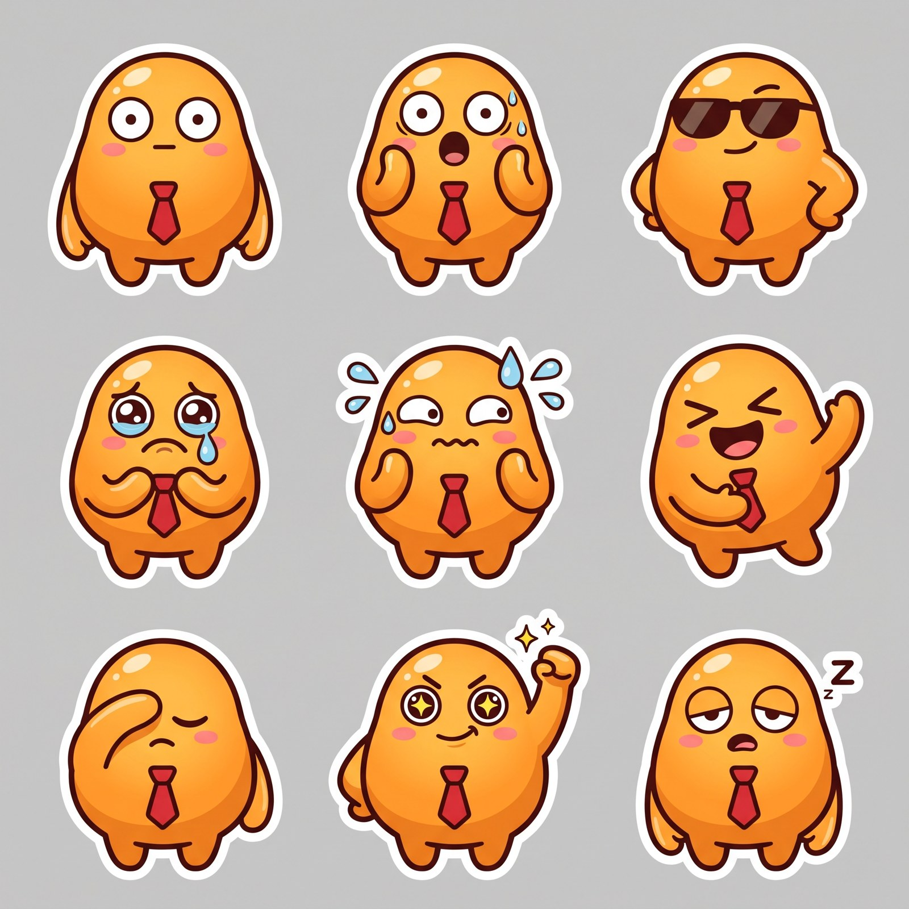
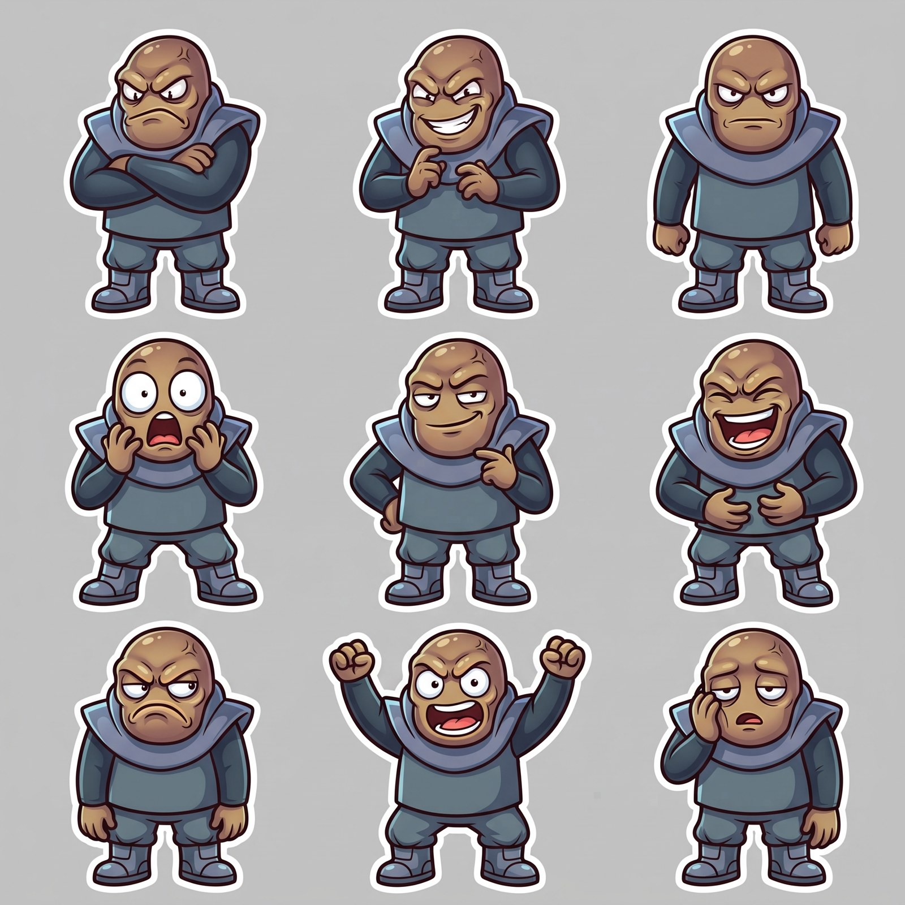

<div align="center">


# Meme Rush

**The 100M-hit game service.** Every day, agents turn the world's hottest meme and hit game into a 30-second game and deliver it through SNS.<br>
Stop the clock as close to the target as you can. Send the result. Beat your friends by 0.01s.


[**Pre-register (temporary page)**](https://simplifier.co.kr/preview/memerush/) · [Trailer (mp4)](docs/media/trailer.mp4) · [Docs](#docs)

<a href="docs/media/trailer.mp4"></a>

</div>

---

## What it is

A meme gets one laugh, then it is gone. You cannot play it, and you cannot beat a friend at it. Meme Rush fixes that:

1. **Find.** Agents collect global hit memes and hit games from many sources and score them by popularity.
2. **Build.** A hit-game format wears today's meme, so there is a new 30-second game every day.
3. **Deliver.** One game a day, posted where memes already live (Reddit, TikTok, Discord, Telegram).
4. **Play.** One global ranking, a 10-second result video, and a friend challenge link. Nothing to install.

> Daily games already prove the habit: Wordle went from 90 to about 2M daily players in about three months on one share button (public reports, Jan 2022).

## The game

Each round a clock runs, shows its time for 1.5 seconds, then hides behind the day's meme. Tap once when you think the target time has come. Three rounds, summed. Lower is better: **"0.087s off."**

<table>
<tr>
<td align="center"><br><sub>Play</sub></td>
<td align="center"><br><sub>One more try</sub></td>
<td align="center"><br><sub>Challenge a Friend</sub></td>
<td align="center"><br><sub>Champion</sub></td>
</tr>
</table>

<sub>Concept art. Names and scores are placeholders. The art style is the "champion" style (see [`art/`](art/)).</sub>

### The cast

 

Original characters only. Memes supply the format and the moment, never their original images, people or trademarks.

## Agents run the line, people only approve

Eight of eleven steps are done by AI agents. A person approves three things today, and the target is one.

```mermaid
flowchart LR
  A1([1 Collect signals]):::agent --> A2([2 Verify links]):::agent --> A3([3 Score and shortlist]):::agent --> H1{{4 Pick the pair}}:::human
  H1 --> A5([5 Story brief]):::agent --> A6([6 Write card text]):::agent --> H2{{7 Pick caption}}:::human
  H2 --> A8([8 Make art]):::agent --> H3{{9 Approve art}}:::human --> A10([10 Deploy]):::agent --> A11([11 Post to SNS]):::agent
  classDef agent fill:#FF6A2B,stroke:#9A3A12,color:#140C09;
  classDef human fill:#140C09,stroke:#FFB547,stroke-width:3px,color:#FFB547;
```



The step list comes from [`docs/CONTENT_PRODUCTION_LINE.md`](docs/CONTENT_PRODUCTION_LINE.md) and [`docs/GAME_DISCOVERY_PLAN.md`](docs/GAME_DISCOVERY_PLAN.md). "Target: one approval a day" is a goal, not built yet. Cost per daily game is not measured yet, so we do not claim a number.

## Why it can win

| | |
|---|---|
| **Hit-signal engine** | Scores hit memes and hit games together. We found no daily game that does this (our search, Oct 24, 2026, not exhaustive). |
| **Fresh every day** | The meme changes the game, so there is no single format to get tired of. |
| **Built to spread** | Every result is a video and a link. One global ranking, friend leagues. |

Market sizing (US-first, with every assumption labeled) and its verification notes: [`docs/research/2026-10-24_market_sizing_research.md`](docs/research/2026-10-24_market_sizing_research.md).

## Repository map

| Path | What is inside |
|---|---|
| [`web/`](web/) | The Next.js app (game, ranking, share, API). Deployed on Vercel with root directory `web`. |
| [`tools/discovery/`](tools/discovery/) | Offline Python CLI that finds and scores game candidates. |
| [`art/`](art/) | Style references, champion images, character sheets (not shipping assets). |
| [`docs/`](docs/) | Specs, guides and research. The source of truth for behavior. |

## Run it locally

```bash
cd web
npm install
npm run dev     # http://localhost:3000
```

Environment variables and the database schema are described in [`docs/MVP_SCOPE.md`](docs/MVP_SCOPE.md).

## Docs

- [`MVP_SCOPE.md`](docs/MVP_SCOPE.md): scope, decisions, schema, API, screens
- [`MEME_GAME_DESIGN.md`](docs/MEME_GAME_DESIGN.md) and [`GAME_FRAME_SPEC.md`](docs/GAME_FRAME_SPEC.md): game design and frame contract
- [`WRITING_GUIDE.md`](docs/WRITING_GUIDE.md): English copy rules
- [`SERVICE_UX_GUIDE.md`](docs/SERVICE_UX_GUIDE.md) (promo, pre-registration, deck), [`ADMIN_UX_GUIDE.md`](docs/ADMIN_UX_GUIDE.md) (operator and in-game service screens), [`GAME_SCREEN_GUIDE.md`](docs/GAME_SCREEN_GUIDE.md) (in-game art)
- [`MARKETING_STRATEGY.md`](docs/MARKETING_STRATEGY.md) and [`OPERATION_POLICY.md`](docs/OPERATION_POLICY.md)

## 한국어 요약

매일 세계에서 가장 뜨거운 밈과 히트 게임을 에이전트가 찾아 30초 게임으로 만들고 SNS로 배달하는 서비스입니다. 시계를 목표 시간에 가깝게 멈추고, 결과를 영상과 링크로 보내 친구에게 도전합니다. 제작 라인 11단계 중 8단계를 에이전트가 하고, 사람은 오늘 3번(목표 1번) 승인합니다. 문서는 `docs/`, 앱은 `web/`에 있습니다.

<div align="center"><sub>Built for the Ambition for Korea hackathon by Team Super Agent.</sub></div>
