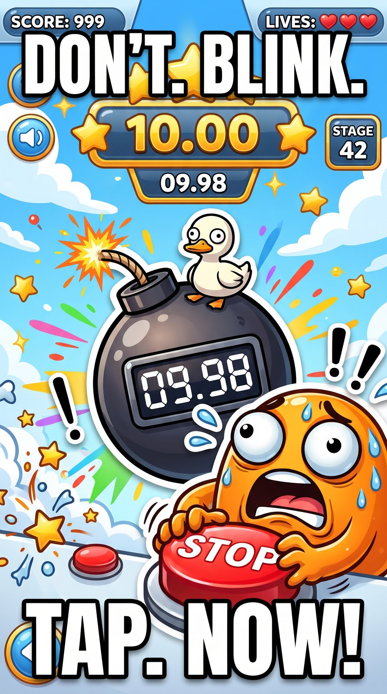
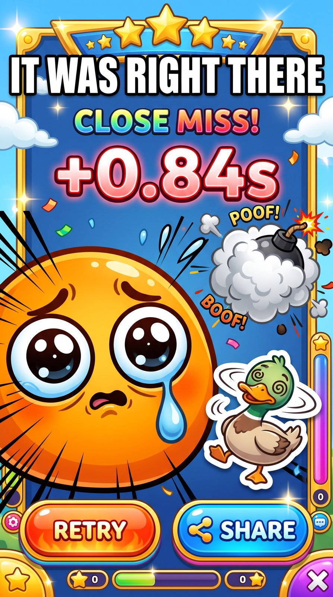
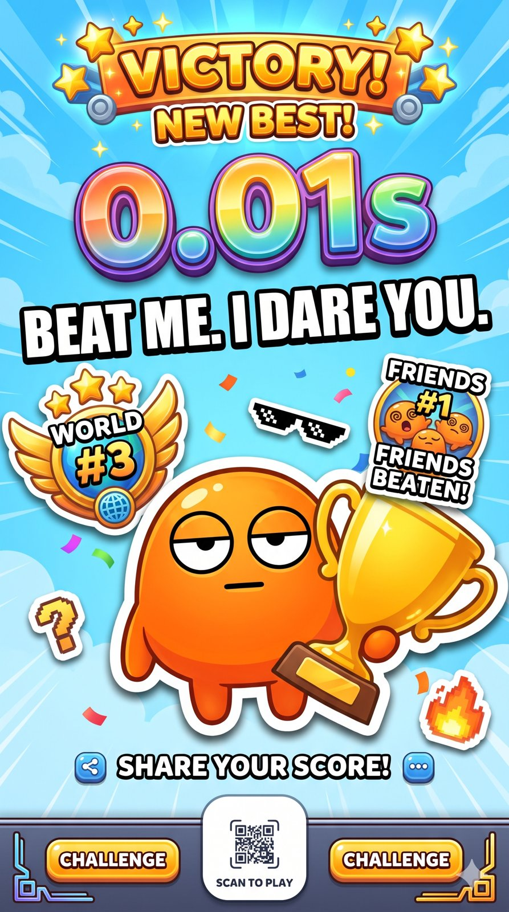
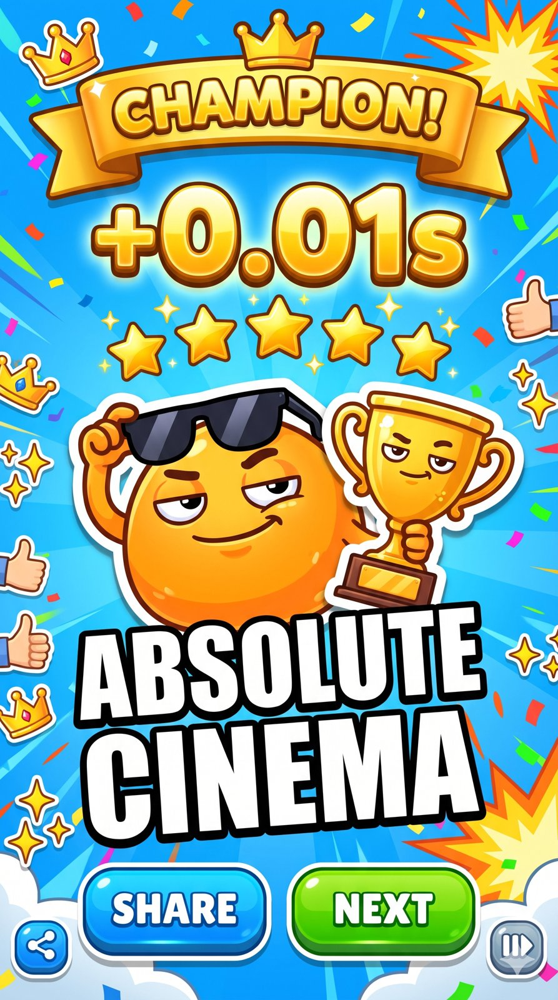

<div align="center">


**Every day, agents turn the world's hottest meme and hit game into a 30-second game and deliver it through SNS.**<br>
Stop the clock as close to the target as you can. Send the result. Beat your friends by 0.01s.


[Pre-register](https://simplifier.co.kr/preview/memerush/) (temporary page) · [Trailer (mp4)](docs/media/trailer.mp4)

<a href="docs/pitch/SuperAgent_MemeRush_pitch.pdf"></a> <a href="docs/pitch/SuperAgent_MemeRush_pitch_KO.pdf"></a>

<a href="docs/media/trailer.mp4"></a>

</div>

## How it works

1. **Find.** Agents collect global hit memes and hit games and score them by popularity.
2. **Build.** A hit-game format wears today's meme: a new 30-second game every day.
3. **Deliver.** One game a day, posted where memes already live (Reddit, TikTok, Discord, Telegram).
4. **Play.** One global ranking, a 10-second result video, a friend challenge link. No install.

Each round a clock runs, then hides behind the day's meme. Tap once at the target time. Three rounds, summed: **"0.087s off."**

<table>
<tr>
<td align="center"><br><sub>Play</sub></td>
<td align="center"><br><sub>One more try</sub></td>
<td align="center"><br><sub>Challenge a Friend</sub></td>
<td align="center"><br><sub>Champion</sub></td>
</tr>
</table>

<sub>Concept art. Names and scores are placeholders.</sub>

## Run locally

```bash
cd web
npm install
npm run dev   # http://localhost:3000
```

Environment variables and the database schema: [`docs/MVP_SCOPE.md`](docs/MVP_SCOPE.md).

## Tech stack

Next.js, React, Phaser (game), Supabase (ranking), Vercel (deploy), Python (discovery CLI in [`tools/discovery`](tools/discovery)).

<details>
<summary>Docs and repository map</summary>

- [`web/`](web/) app · [`tools/discovery/`](tools/discovery/) candidate finder · [`art/`](art/) style references
- [`MVP_SCOPE.md`](docs/MVP_SCOPE.md) scope, schema, API · [`MEME_GAME_DESIGN.md`](docs/MEME_GAME_DESIGN.md) and [`GAME_FRAME_SPEC.md`](docs/GAME_FRAME_SPEC.md) game design
- [`CONTENT_PRODUCTION_LINE.md`](docs/CONTENT_PRODUCTION_LINE.md) and [`GAME_DISCOVERY_PLAN.md`](docs/GAME_DISCOVERY_PLAN.md) the agent line
- [`WRITING_GUIDE.md`](docs/WRITING_GUIDE.md), [`SERVICE_UX_GUIDE.md`](docs/SERVICE_UX_GUIDE.md), [`ADMIN_UX_GUIDE.md`](docs/ADMIN_UX_GUIDE.md), [`GAME_SCREEN_GUIDE.md`](docs/GAME_SCREEN_GUIDE.md) copy and UX rules
- [`MAYA_WORK_SUMMARY.md`](docs/MAYA_WORK_SUMMARY.md) what the marketing agent produced for the hackathon
- [`MARKETING_STRATEGY.md`](docs/MARKETING_STRATEGY.md), [`OPERATION_POLICY.md`](docs/OPERATION_POLICY.md), [market sizing notes](docs/research/2026-10-24_market_sizing_research.md)

</details>

<details>
<summary>한국어 요약</summary>

매일 세계에서 가장 뜨거운 밈과 히트 게임을 에이전트가 찾아 30초 게임으로 만들고 SNS로 배달합니다. 시계를 목표 시간에 가깝게 멈추고 결과를 영상과 링크로 보내 친구에게 도전합니다. 제작 라인 11단계 중 8단계를 에이전트가 하고 사람은 지금 3번(목표 1번) 승인합니다.

</details>

<div align="center"><sub>Built for the Ambition for Korea hackathon by Team Super Agent.</sub></div>
